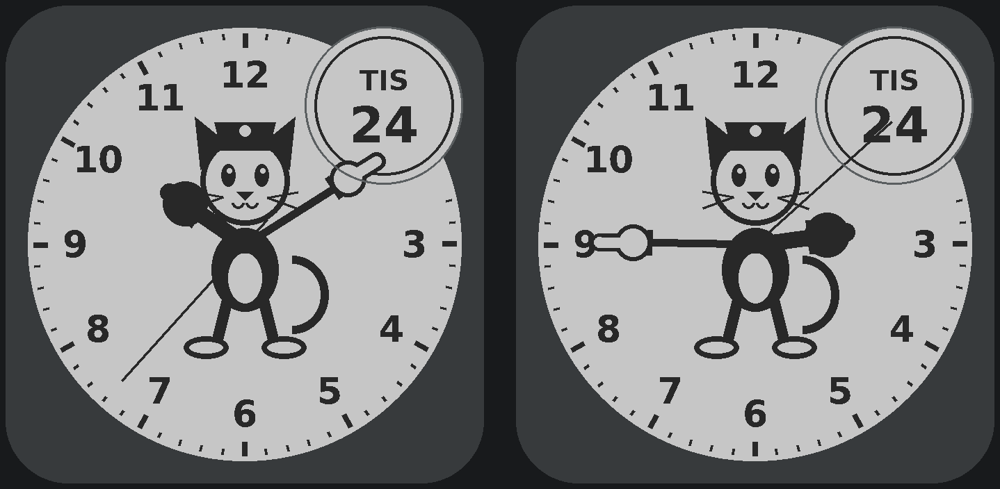

# Kapten Katt – figurklocka för Garmin Instinct 2S

En klassisk visartavla där en tecknad katt med kaptensmössa står mitt på
urtavlan och pekar ut tiden med armarna: den korta armen visar timmar och den
långa armen minuter.



*Förhandsbilden är ritad med samma geometri som koden men med ungefärliga typsnitt.*

- Siffrorna 1–12 med minutstreck
- **Timvisare:** kort, tjock arm med svart handske
- **Minutvisare:** lång, smal arm med vit handske och långt pekfinger
- Tunn sekundvisare som syns när du tittar på klockan
- Veckodag och datum i det runda fönstret uppe till höger

## Inställningar

- **Mörk urtavla**: ljust på mörkt i stället för mörkt på ljust (av som standard).

## Bygga och installera

Samma steg som för `garmin-marathon-watchface`, se dess README. Kort version:

```sh
monkeyc -f monkey.jungle -d instinct2s -y /sökväg/till/developer_key.der -o bin/KaptenKatt.prg
```

Kopiera sedan `.prg`-filen till `GARMIN/APPS` på klockan.
