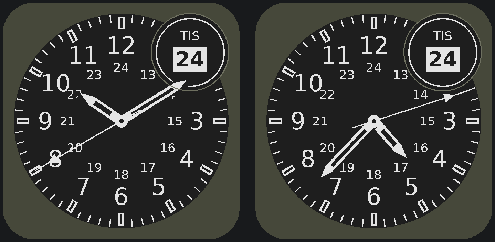
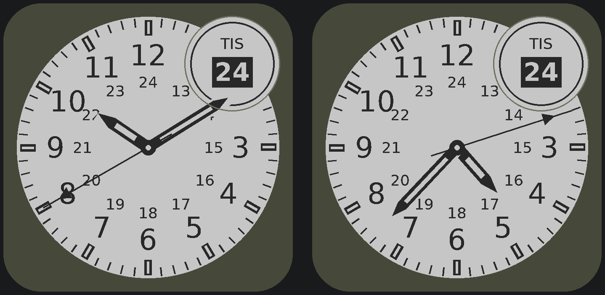

# Field – fältklocka för Garmin Instinct 2S

En analog urtavla i klassisk militär fältklocke-stil för Connect IQ.



*Förhandsbilden är ritad med samma geometri som koden men med ungefärliga typsnitt.*

- Siffrorna 1–12 och en inre 24-timmarsring (13–24)
- Hålade timmarkeringar och minutstreck
- Ihåliga visare och en tunn sekundvisare med pilspets, som syns när du tittar på klockan
- Veckodag och datumfönster i det runda fönstret uppe till höger

## Ljus version

Det finns också en inverterad version, **Field Ljus**, med mörka visare och siffror på ljus urtavla.
Den har ett eget app-id, så du kan ha båda installerade och växla mellan dem på klockan.



## Inställningar

- **Ljus urtavla**: mörkt på ljust i stället för ljust på mörkt (av som standard).
- **Visa 24-timmarsring** (på som standard). Ringen döljs också automatiskt om typsnittet är för stort för skärmen.

## Bygga och installera

1. Installera [Connect IQ SDK Manager](https://developer.garmin.com/connect-iq/sdk/), logga in
   med ditt Garmin-konto och ladda ner senaste SDK:n plus enheten **Instinct 2S**.
2. Installera tillägget **Monkey C** i VS Code.
3. Kör `Monkey C: Generate a Developer Key` (görs en gång).
4. Öppna den här mappen och kör `Monkey C: Run`, välj `instinct2s`. Simulatorn startar.
5. För att installera på klockan: kör `Monkey C: Build for Device`, koppla klockan med USB
   och kopiera `.prg`-filen till mappen `GARMIN/APPS` på klockan.
6. På klockan: håll inne **MENU**, välj **Watch Face**, sedan urtavlan och **Apply**.

Från kommandoraden:

```sh
# Mörk version
monkeyc -f monkey.jungle -d instinct2s -y /sökväg/till/developer_key.der -o bin/Field.prg
# Ljus version
monkeyc -f monkey-light.jungle -d instinct2s -y /sökväg/till/developer_key.der -o bin/FieldLjus.prg
```

I VS Code väljer du vilken jungle-fil som gäller under inställningen **Monkey C: Jungle Files**
(`monkey.jungle` eller `monkey-light.jungle`).
