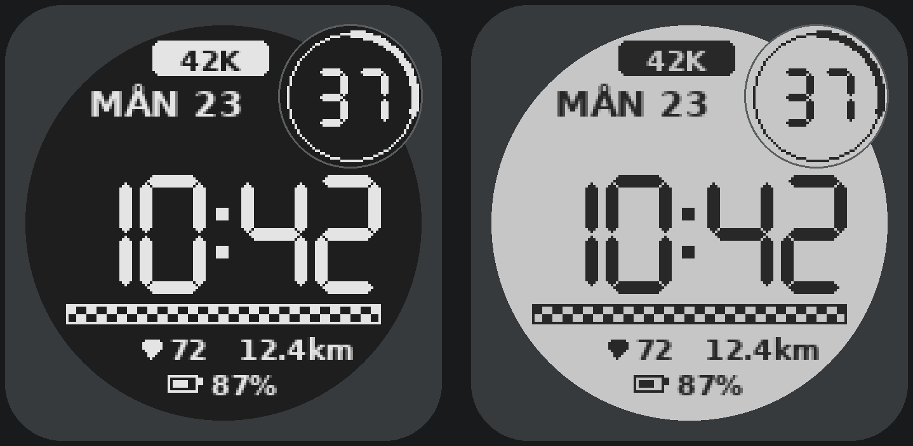

# Marathon – urtavla för Garmin Instinct 2S

En urtavla i målklocke-stil för Connect IQ, skriven i Monkey C.



*Förhandsbilden är ritad med samma geometri som koden men med ungefärliga typsnitt.
Den riktiga klockan använder Garmins egna systemtypsnitt.*

## Vad den visar

| Plats | Innehåll |
|---|---|
| Mitten | Stor tid i sjusegmentssiffror, som en målklocka (24 h eller 12 h enligt klockans inställning) |
| Runda fönstret uppe till höger | Sekunder, med en ring som fylls efter hur stor del av ett maraton (42,195 km / 26,2 mi) du har gått eller sprungit i dag |
| Uppe till vänster | Etiketten "MARATHON" (eller "42K" om utrymmet inte räcker) och veckodag + datum |
| Under tiden | Målflagga i rutmönster |
| Nederst | Puls, dagens distans och batteri |

Sekunderna uppdateras varje sekund även i viloläge, men bara i det lilla fönstret,
så att batteriet sparas. Om klockan säger att urtavlan drar för mycket ström visas
sekunderna i stället bara när du tittar på klockan.

## Inställningar

- **Ljus bakgrund**: mörka siffror på ljus bakgrund i stället för tvärtom (av som standard).
- **Visa sekunder**: när det är av visas i stället procent av maratondistansen i det runda fönstret.

## Bygga och testa

1. Installera [Connect IQ SDK Manager](https://developer.garmin.com/connect-iq/sdk/), logga in
   med ditt Garmin-konto och ladda ner senaste SDK:n plus enheten **Instinct 2S**.
2. Installera tillägget **Monkey C** i VS Code.
3. Kör `Monkey C: Generate a Developer Key` (görs en gång).
4. Öppna den här mappen och kör `Monkey C: Run`, välj `instinct2s`. Simulatorn startar.
5. För att installera på klockan: kör `Monkey C: Build for Device`, koppla klockan med USB
   och kopiera `.prg`-filen till mappen `GARMIN/APPS` på klockan.

Från kommandoraden:

```sh
monkeyc -f monkey.jungle -d instinct2s -y /sökväg/till/developer_key.der -o bin/Marathon.prg
```
